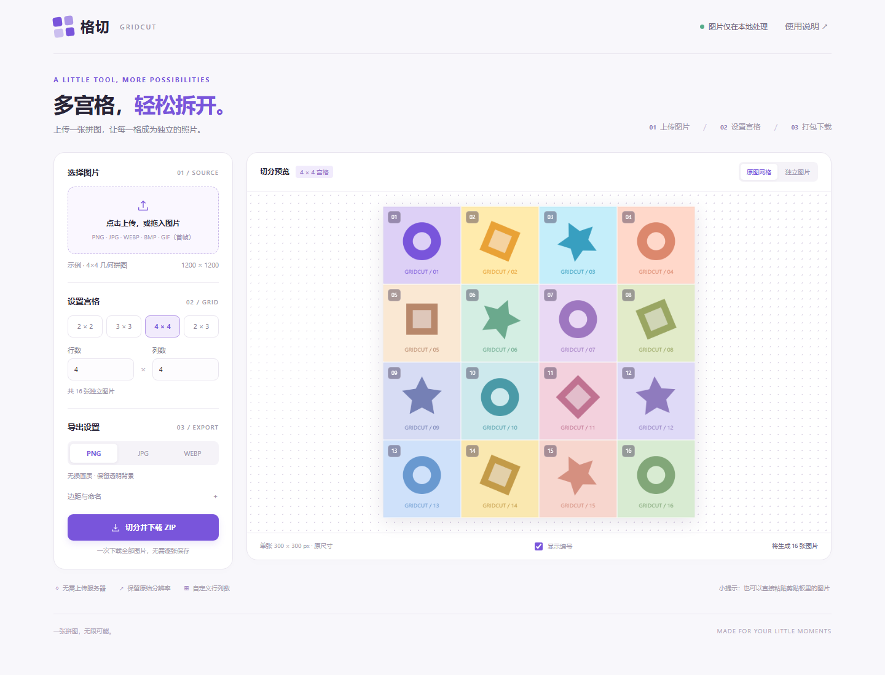

# 格切 Gridcut

把一张多宫格图片切成独立照片的轻量网页工具。纯 HTML、CSS 和 JavaScript，零运行时依赖，不需要 AI、API Key、账号或后端。

**[在线使用](https://virtue192.github.io/gridcut/)** · [下载源码](https://github.com/virtue192/gridcut/archive/refs/heads/main.zip)

## 使用

1. 下载本仓库，双击 `index.html` 打开；也可以使用 GitHub Pages 在线版。
2. 上传、拖入或粘贴图片，按实际排版设置行数和列数。
3. 选择 PNG、JPG 或 WebP，点击「切分并下载 ZIP」。

在「独立图片」里点击任意一格，可以放大查看并单张下载。



## 功能

- 2×2、3×3、4×4、2×3 预设，以及自定义行列数。
- PNG、JPG、WebP 导出，JPG / WebP 可调质量。
- ZIP 一次下载全部切图，支持中文文件名前缀。
- 可设置上下 / 左右外边距，以及行间距 / 列间距。
- 保留原始分辨率，不缩放；按从左到右、从上到下的顺序命名。
- 原图网格和独立图片两种预览，支持手机浏览器。
- 图片在浏览器内处理，不上传服务器，不使用分析脚本或外部 CDN。
- 内置示例由 Canvas 绘制几何图案，不包含用户上传的图片。

## 切分规则与限制

工具按**等分网格**切分，需要手动指定实际行列数；不会自动检测格子或识别不规则排版。比如 4 行 × 4 列会导出 16 张图片。

尺寸不能整除时，使用累积分界点四舍五入分配像素。例如 1254×1254 图片切成 4×4，单格宽高为 313 或 314 像素，原图像素不会丢失。设置的外边距和格间距会被裁掉。

- 输入支持 PNG、JPG、WebP、BMP、GIF；GIF 固定使用第一帧。
- JPG 不支持透明度，透明区域会填充为白色。
- 每个方向最多 30 格，一次最多 400 张，每格至少 1×1 像素。
- 输入文件最多 60 MB、6000 万像素；输出总量最多 200 MB。浏览器的可用内存和 Canvas 上限也会影响大图处理。
- 导出为重新编码的图片，不保留 EXIF 等原始文件元数据。
- 建议使用较新的 Chrome、Edge、Firefox 或 Safari；格式导出能力以浏览器支持为准。

## 本地开发

无需安装依赖，直接打开 `index.html` 即可开发。如需 HTTP 服务，可以在项目目录执行：

```sh
python -m http.server 8080
```

然后打开 `http://localhost:8080`。

```text
index.html          页面结构
styles.css          响应式样式
app.js              文件读取、预览、Canvas 切图与下载交互
core.js             网格坐标计算、CRC32 和 ZIP 写入
tests/core.test.cjs  网格及 ZIP 测试
```

运行核心测试需要 Node.js 20 或更新版本，无需 `npm install`：

```sh
npm test
```

测试覆盖不可整除尺寸的像素完整性、边距和间距、非法参数、CRC32 标准向量、UTF-8 ZIP 文件名及 ZIP 目录结构。

## 部署到 GitHub Pages

这是普通静态网页，可部署到 GitHub Pages 或任意静态托管服务。

仓库内置 Pages 工作流。到仓库 **Settings → Pages → Build and deployment → Source** 选择 **GitHub Actions**，然后在 Actions 页面运行 **Deploy GitHub Pages**，或推送到 `main`。工作流只发布页面文件，不会把测试和仓库配置发布为站点内容。

## 参与贡献

欢迎通过 Issue 描述问题或提出需求，通过 Pull Request 提交改进。修改网格计算和 ZIP 写入时，请同时补充相应测试并运行 `npm test`。项目保持纯静态和零运行时依赖，新增网络请求或后端能力请先讨论。

## License

[MIT](LICENSE) © 2026 virtue192
